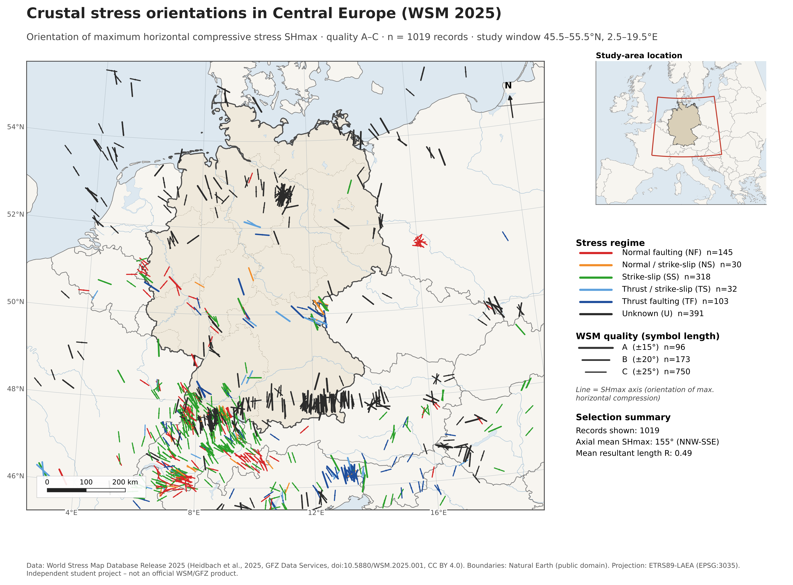
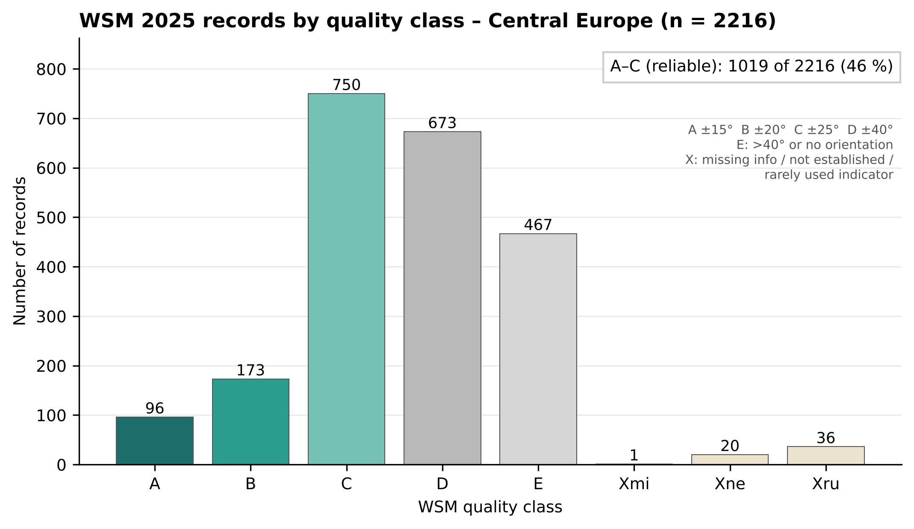
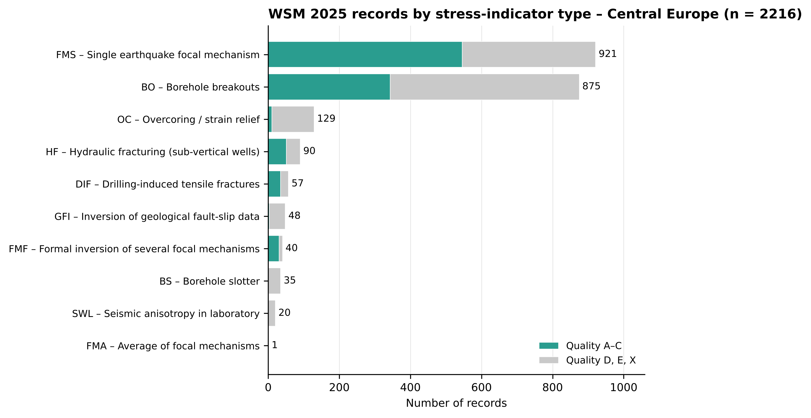
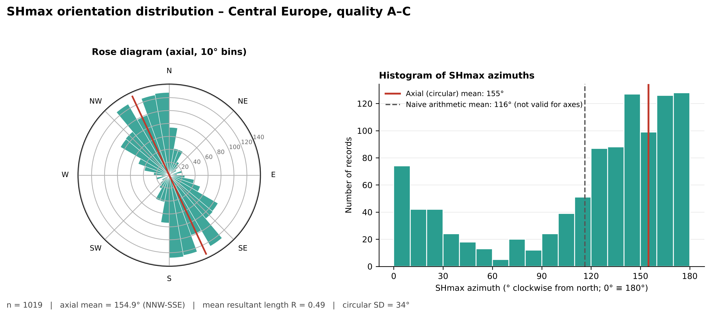

# Crustal stress patterns in Central Europe (World Stress Map 2025)

A Python workflow to clean, filter, analyse and map the orientation of the maximum
horizontal stress (SHmax) in Germany and Central Europe, using the public
**World Stress Map Database Release 2025**.



## Why this project

I wanted to understand how the World Stress Map (WSM) data are structured, how the
quality ranking works and how a stress map can be produced from the database in a
reproducible way – similar in idea to the WSM online tool CASMO
(region + quality + indicator → map).

## Data

- **WSM Database Release 2025** – Heidbach, O., Rajabi, M., Di Giacomo, D., Harris, J.,
  Lammers, S., Morawietz, S., Pierdominici, S., Reiter, K., von Specht, S., Storchak, D.,
  Ziegler, M. O. (2025). GFZ Data Services. https://doi.org/10.5880/WSM.2025.001 (CC BY 4.0)
- Field definitions and quality scheme: WSM Technical Report 25-01,
  https://doi.org/10.48440/wsm.2025.001
- Country borders, rivers and lakes: [Natural Earth](https://www.naturalearthdata.com) (public domain)

The WSM CSV (~15 MB) is not stored in this repository. `run_analysis.py` downloads it
automatically; if that fails, download `WSM_Database_2025.csv` from the DOI above and put it
in `data/raw/`. More details in [`data/README.md`](data/README.md).

## What the code does

1. Reads the CSV and checks the important fields (see [`docs/wsm_fields.md`](docs/wsm_fields.md)).
2. Cleans the data: removes records without coordinates, converts `AZI = 999`
   ("no orientation") to missing, treats 180° as 0°.
3. Converts the table to a GeoDataFrame (EPSG:4326).
4. Selects the study area: Germany (country polygon) and a Central Europe window
   (45.5–55.5°N, 2.5–19.5°E).
5. Keeps quality **A–C** records (SHmax accurate to ±15° / ±20° / ±25°).
6. Counts records by quality and stress-indicator type.
7. Computes the mean SHmax orientation with **axial statistics** (angle doubling),
   because 0° and 180° are the same orientation.
8. Draws stress maps (ETRS89-LAEA, EPSG:3035) and charts.
9. `filter_stress_data()` – a small CASMO-like filter: choose region, quality and indicator,
   get the selected records and a new map.
10. Exports the selections as CSV and GeoPackage and runs a few validation checks.

## How to run

```bash
pip install -r requirements.txt
python run_analysis.py                 # full workflow, figures and exports
jupyter notebook notebooks/01_world_stress_map_analysis.ipynb
streamlit run app/streamlit_app.py     # optional small app
```

Example of the filter function:

```python
from src.data_processing import load_wsm_data, clean_wsm_data, to_geodataframe
from src.filtering import filter_stress_data

gdf = to_geodataframe(clean_wsm_data(load_wsm_data())[0])
sel, steps, fig = filter_stress_data(gdf, region="Switzerland", quality="C",
                                     indicator="FM*", make_map=True)
```

`quality="C"` means A, B and C. `region` can be a preset name, a bounding box
`(lon_min, lat_min, lon_max, lat_max)` or a list of country names.

## Results

| | Central Europe window | Germany |
|---|---|---|
| Records | 2216 | 791 |
| Quality A–C | 1019 (46 %) | 297 (38 %) |
| Main indicators (A–C) | focal mechanisms 546, breakouts 343 | breakouts 169, focal mechanisms 80 |
| Mean SHmax (A–C, axial) | ≈155° (NW–SE to NNW–SSE), R = 0.49 | ≈168°, R = 0.56 |

- The arithmetic mean of the same azimuths would be 116°, which is clearly wrong – this is
  why axial statistics are needed.
- The orientation is not uniform across the region: roughly N–S in the eastern Molasse
  Basin, NW–SE in northern Switzerland and south-west Germany, and NNE–SSW around
  10–12°E, 52–53°N.
- The general NW–SE trend agrees with the known stress pattern of western and central
  Europe (e.g. Müller et al., 1992; Heidbach et al., 2018). I did not try to interpret the
  local differences.

| Quality classes | Indicator types |
|---|---|
|  |  |



More figures are in [`figures/`](figures/) (Germany map, before/after quality filter,
rose diagrams by indicator, 1° grid means, CASMO-like example).

## Checks

`run_analysis.py` checks coordinate and azimuth ranges, unique IDs, CRS, record counts
after each filter, the axial mean with known examples, the orientation of the drawn map
symbols, and that the exported files contain exactly the selected records.
Results are written to [`docs/validation_report.md`](docs/validation_report.md).

## Limitations

- The data are unevenly distributed (many records in basins and seismically active areas,
  few elsewhere).
- Different methods (earthquakes, borehole breakouts, overcoring, …) measure stress at
  different depths and scales.
- Many borehole records have an unknown stress regime.
- One regional mean hides local changes; the 1° grid means are a simple binning, not the
  WSM smoothing method.
- Geological interpretation is outside the scope of this project.

## Repository structure

```
src/                data_processing.py, filtering.py, orientation_stats.py, plotting.py
run_analysis.py     runs the full workflow
notebooks/          step-by-step notebook
app/                Streamlit app
data/raw/           Natural Earth layers (WSM CSV is downloaded here)
figures/, outputs/  results
docs/               field notes and validation report
```

## Note

This is an independent student project. It is not official GFZ / World Stress Map software
and not CASMO. Please cite the WSM database (see Data) if you use these data.

## References

- Heidbach, O., Rajabi, M., et al. (2018). The World Stress Map database release 2016: Crustal stress pattern across scales. *Tectonophysics*, 744, 484–498.
- Heidbach, O., Rajabi, M. (2026). Patterns of contemporary horizontal stress orientation in the Earth's crust derived from the World Stress Map Database 2025. *Solid Earth*, 17(5), 735–745.
- Müller, B., et al. (1992). Regional patterns of tectonic stress in Europe. *J. Geophys. Res.*, 97(B8), 11783–11803.
- Mardia, K. V., Jupp, P. E. (2000). *Directional Statistics*. Wiley.

## Licence

Code: MIT (see `LICENSE`). The World Stress Map 2025 data keep their own licence, CC BY 4.0 by their authors (https://doi.org/10.5880/WSM.2025.001).
